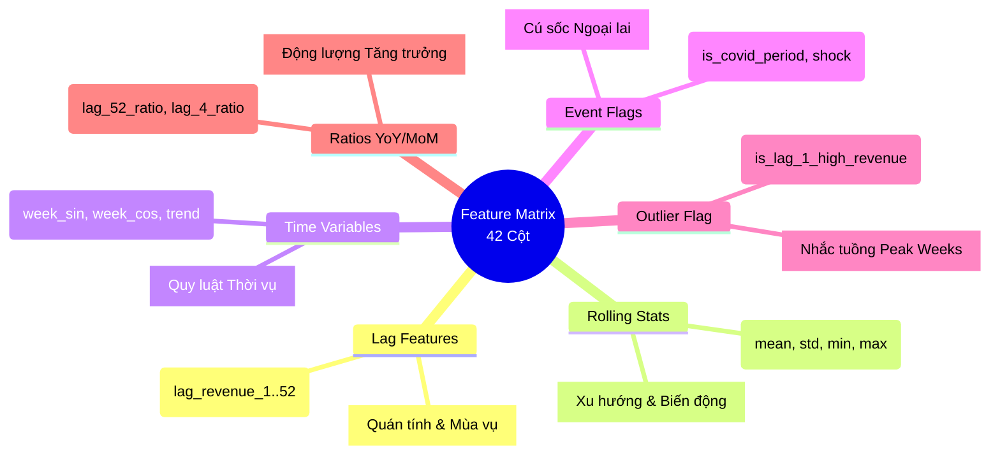
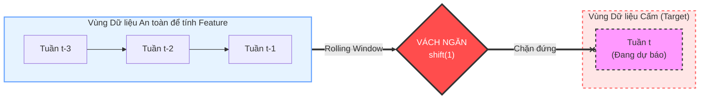
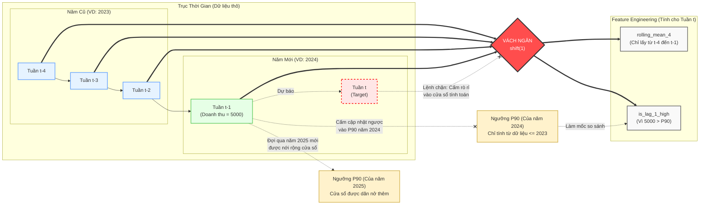

# Hướng dẫn Xây dựng Slide Báo cáo: Feature Engineering & Data Leakage

Tài liệu này phác thảo cấu trúc và nội dung chi tiết cho các slide thuyết trình (hoặc poster báo cáo) về kỹ thuật trích xuất đặc trưng (Feature Engineering) và cơ chế chống rò rỉ dữ liệu (Data Leakage). Đây là một "điểm sáng" (selling point) rất mạnh về kỹ thuật mà bạn cần nhấn mạnh trước hội đồng bảo vệ.

---

## Slide 1: Xây dựng Bộ đặc trưng (Feature Space)
**Mục tiêu của Slide:** Trình bày sự đa dạng và tư duy thiết kế các biến đầu vào cho mô hình Hybrid XGBoost. Trả lời câu hỏi: *Mô hình học từ những khía cạnh nào của dữ liệu?*

**Nội dung Bullet Points:**
*   **5.1. Lag Features (Đặc trưng trễ):** 14 cột gồm `lag_revenue_1` đến `lag_revenue_12` (phủ trọn 1 quý), `lag_revenue_26` (nửa năm), `lag_revenue_52` (cùng kỳ năm ngoái) nhằm bắt lấy tính tự tương quan ngắn hạn và chu kỳ mùa vụ.
*   **5.2. Rolling Features (Đặc trưng cửa sổ trượt):** 16 cột gồm `mean`, `std`, `min`, `max` cho các cửa sổ 4, 8, 12 và 26 tuần. Đại diện cho xu hướng mượt mà, định vị ngưỡng biên (min/max) và đo lường độ biến động (volatility/std) của thị trường từ ngắn hạn (1 tháng) đến trung hạn (nửa năm).
*   **5.3. Time Features (Định vị thời gian & Chu kỳ):** Ngoài Tháng/Quý thông thường, dự án áp dụng **Cyclic Encoding** (`week_sin`, `week_cos`) để uốn trục thời gian thành hình tròn, giúp mô hình hiểu Tuần 52 nối liền với Tuần 1. Kết hợp cùng `trend_index` giúp XGBoost nhận thức được thời gian trôi qua và bắt được xu hướng tăng trưởng vĩ mô dài hạn.
*   **5.4. COVID/Event Features (Đặc trưng sự kiện & Bất thường):** Gồm 3 cột: `is_covid_period`, `is_covid_shock` (biến giả đánh dấu giai đoạn đại dịch và phong tỏa) và `is_lag_1_high_revenue` (cờ đánh dấu các mốc doanh thu cao bất thường lặp lại trong lịch sử).
*   **5.5. Ratio Features (Đặc trưng tỷ lệ YoY/MoM):** Tỷ lệ tăng trưởng so với tuần cùng kỳ năm ngoái (`lag_52_ratio`) và tháng trước (`lag_4_ratio`), đại diện cho động lượng (momentum) bứt phá.

**Minh chứng / Visuals nên đưa vào (Copy mã Mermaid bên dưới để tạo sơ đồ tư duy):**

---

## Slide 2: Nguyên lý Thiết kế Cốt lõi: Chống Rò rỉ Dữ liệu
**Mục tiêu của Slide:** Thể hiện sự hiểu biết sâu sắc về cạm bẫy Data Leakage trong Time Series và cách dự án giải quyết triệt để.

**Nội dung Bullet Points:**
*   **Nguyên tắc vàng:** Tại thời điểm dự báo $t$, mọi đặc trưng đầu vào $Feature(t)$ **CHỈ ĐƯỢC TÍNH TOÁN** từ dữ liệu quan sát được trong quá khứ ($y_{t-1}, y_{t-2},...$). Tuyệt đối không để giá trị thực tế $Target(t)$ rò rỉ vào dữ liệu huấn luyện.
**Option 1: Trình bày dạng liệt kê diễn giải (Dành cho báo cáo Word/Poster)**
*   **Kỹ thuật xử lý cụ thể (Cần đọc nhấn mạnh khi thuyết trình):**
    *   **Rolling Window an toàn:** Các hàm `rolling_mean` và `rolling_std` được ép buộc kết hợp với lệnh `shift(1)` trước khi tính toán. Đảm bảo cửa sổ trượt luôn lùi về quá khứ 1 bước chứ không chứa giá trị của tuần hiện tại.
    *   **Outlier / Event Flags an toàn:** Cờ đánh dấu doanh thu cao bất thường (`is_lag_1_high_revenue`) không so sánh doanh thu hiện tại với ngưỡng. Thay vào đó, thuật toán so sánh `lag_revenue_1` (doanh thu tuần trước) với ngưỡng p90 nở dần (Dynamic Expanding p90), đảm bảo tuyệt đối không rò rỉ dữ liệu tương lai hay hiện tại. (Đây là một minh chứng kỹ thuật rất tốt).

**Option 2: Trình bày dạng bảng so sánh cực ngắn gọn (Khuyên dùng cho Slide PPT)**
*Thay vì dùng nhiều chữ, bạn chỉ chiếu bảng này lên slide, kết hợp chỉ tay vào 2 dòng mã giả (Pseudo-code) bên dưới và dùng miệng để giải thích chi tiết.*

| Nhóm Đặc trưng | Lỗi rò rỉ phổ biến (Sai) | Giải pháp Kỹ thuật của dự án (Đúng) |
| :--- | :--- | :--- |
| **Rolling Window** | Trượt đè lên target hiện tại ($t$) | Ép buộc `shift(1)` để chỉ nhìn đến ($t-1$) |
| **Outlier Flag** | So sánh target hiện tại với ngưỡng tĩnh | So sánh `lag_revenue_1` với `Dynamic p90` (Ngưỡng động nở dần) |

**Minh chứng / Visuals nên đưa vào (Dùng chung cho cả 2 Option):**
Thay vì dùng mã giả (pseudo-code) có thể hơi khô khan, bạn có thể dùng 1 trong 2 cách vẽ cực kỳ trực quan sau để thay thế:

*   **Cách 1: Trực quan bằng sơ đồ Dòng thời gian (Timeline/Window Box)**
    *(Bạn có thể copy mã Mermaid bên dưới để sinh ra ảnh hoặc tự vẽ lại theo bố cục này)*

    *   Mục đích: Sơ đồ này chia rõ ranh giới "Vùng an toàn" và "Vùng cấm". Khán giả nhìn vào sẽ thấy ngay cái "vách ngăn đỏ" (đại diện cho hàm `shift`). Vách ngăn này chặn đứng mọi sự lan truyền của cửa sổ tính toán, không cho phép nó chạm vào ô `Tuần t`.

*   **Cách 2: Trực quan bằng sơ đồ Dòng chảy Dữ liệu (Hiển thị "Lag Chéo" và "P90 Dãn nở")**
    *(Đây là sơ đồ cực kỳ mạnh mẽ để giải thích cách chống Data Leakage triệt để của dự án)*

    *   Mục đích: Sơ đồ "Tất cả trong một" này được vẽ **nằm ngang (Horizontal)** cực kỳ tối ưu để dán vào slide PPT. Nó giải thích hoàn hảo cả 2 ý:
        *   (1) **Rolling Window & `shift(1)`:** Khán giả thấy rõ Vách ngăn đỏ chặn đứng dòng thời gian, khiến `rolling_4` chỉ được gom 4 ô xanh (Quá khứ) mà bị cấm tiệt chạm vào ô đỏ (Target).
        *   (2) **P90 Dãn nở:** Số 5,000 của Tuần `t-1` bị cấm cập nhật ngược vào ngưỡng P90 năm nay (ngăn Leakage), và phải chờ đến năm sau mới được thu thập để nới rộng cửa sổ. 

---

## Slide 3: Kết quả Khảo kiểm Rò rỉ Dữ liệu (Leakage Audit)
**Mục tiêu của Slide:** Đưa ra bằng chứng thực nghiệm (hard evidence) chứng minh hệ thống đã "làm sạch" dữ liệu thành công.

**Nội dung Bullet Points:**
*   Hệ thống Feature Engineering được tích hợp kịch bản Audit tự động trước khi nạp vào XGBoost.
*   Kết quả cho thấy sự phân tách hoàn hảo về mặt thời gian giữa tập Train, Validation và Test, không xảy ra hiện tượng chồng lấn (overlap).
*   **Ví dụ minh họa tính chặt chẽ:** Kiểm tra chéo (Cross-check) tại thời điểm nhạy cảm. Giá trị `lag_revenue_1` của tuần đầu tiên thuộc tập Test (Tuần 1, 2025) khớp chính xác 100% với doanh thu của tuần liền trước đó (Tuần cuối cùng của năm 2024).

**Minh chứng / Visuals nên đưa vào:**
*   **Bảng PASS/FAIL Audit (Trực quan hóa kết quả test):**

| Channel | Kiểm tra Overlap (Train/Val/Test) | Kiểm tra Feature Shift (t vs t-1) | Audit Status |
| :--- | :--- | :--- | :--- |
| **Total** | 0% Chồng lấn | Không rò rỉ | **[ PASS ]** |
| **Online**| 0% Chồng lấn | Không rò rỉ | **[ PASS ]** |
| **Store** | 0% Chồng lấn | Không rò rỉ | **[ PASS ]** |
| **Mobile**| 0% Chồng lấn | Không rò rỉ | **[ PASS ]** |

*   **Hình ảnh chứng minh ví dụ `lag_revenue_1`:** Cắt (crop) một hình ảnh nhỏ từ dữ liệu thực tế (hoặc log từ console) cho thấy:
    > `df_test.loc['2025-01-06', 'lag_revenue_1'] == df_val.loc['2024-12-30', 'target_revenue']` -> **TRUE**

---

## Lời khuyên khi thuyết trình phần này:
*   Đừng dành quá nhiều thời gian đọc lại từng tên feature. Hãy lướt nhanh slide 1 và dồn trọng tâm thời gian vào **Slide 2 và Slide 3**.
*   Các hội đồng chấm thi Data Mining / AI rất hay "xoáy" sinh viên vào câu hỏi: *"Em tính trung bình trượt 4 tuần, vậy cái 4 tuần đó có bao gồm tuần em đang dự báo không? Nếu có thì em đang ăn gian (cheating) mô hình!"*
*   Slide số 2 chính là lá chắn thép để bạn đáp lại câu hỏi đó một cách tự tin. Khẳng định mạnh mẽ cụm từ *"Em đã dùng kỹ thuật shift lùi tịnh tiến"* sẽ mang lại điểm tuyệt đối ở khâu xử lý dữ liệu.

---

## Slide 4 (Slide Phòng ngự Dự phòng): Feature Quality Diagnostic
**Mục tiêu của Slide:** Đây là slide "vũ khí bí mật" không cần chiếu ngay từ đầu, chỉ bật lên khi Hội đồng đặt câu hỏi hóc búa: *"Nếu những năm trước doanh thu thấp (do Covid), những năm sau doanh thu cao lên thì ngưỡng P90 cũ có làm cả năm sau bị cắm cờ (Flag = 1) liên tục không?"*

**Nội dung Bullet Points:**
*   Để chống lại hiện tượng "Bão hòa đặc trưng" (Feature Saturation / Distribution Shift), nhóm đã tiến hành **Thực nghiệm chẩn đoán (Diagnostic)** để đo lường Tỷ lệ kích hoạt cờ (Flag Rate).
*   **Kết luận vững chắc:** Dữ liệu thực tế chứng minh tỷ lệ Flag Rate luôn dao động ổn định trong ngưỡng từ **3% đến 17%** qua tất cả các năm ở mọi kênh. Không có năm nào xảy ra hiện tượng bão hòa (>50%). Điều này chứng minh ngưỡng P90 chốt theo năm vẫn giữ được năng lực phân biệt (discriminatory power) tuyệt vời, chỉ đánh dấu đúng những sự kiện Đỉnh.

**Minh chứng / Visuals nên đưa vào:**
*   **Bảng Tỷ lệ Kích hoạt Cờ (Flag Rate):**

| Năm | Kênh TOTAL | Kênh ONLINE | Kênh STORE | Kênh MOBILE |
| :--- | :--- | :--- | :--- | :--- |
| **2023** | **3.85% (2 tuần)** | 11.54% | 13.46% | **0.00% (0 tuần)** |
| **2024** | **5.66% (3 tuần)** | 13.21% | 7.55% | 5.66% |
| **2025** | 13.46% (7 tuần) | 17.31% | 11.54% | 5.77% |

*   *Lời bình khi chiếu slide này:* "Như quý thầy cô thấy, kênh TOTAL năm 2023 chỉ có 2 tuần bật cờ (3.85%), kênh MOBILE thậm chí không có tuần nào vượt được kỷ lục cũ (0%). Lịch sử P90 đang làm cực kỳ tốt nhiệm vụ gác cổng của nó!"
